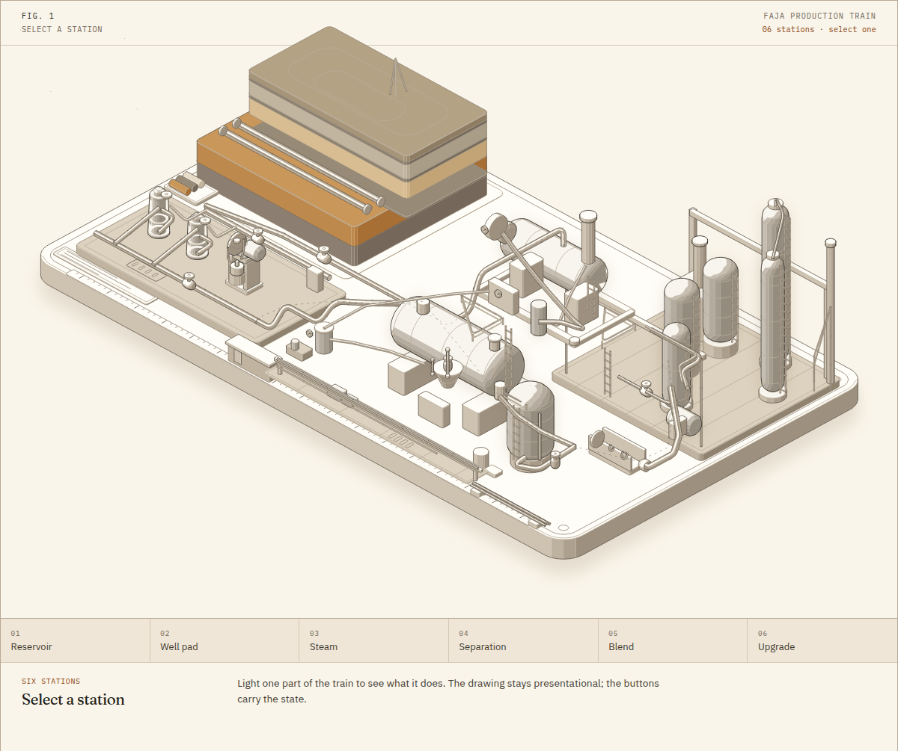

# Faja 8°

An interactive field guide to extra-heavy crude production in the Orinoco Belt: the Oficina reservoir, cold production, steam, PCP lift, separation, blending and upgrading, with one isometric production-train cutaway and one illustrative systems model.

[**Open the live field guide →**](https://gerrcass.github.io/faja-heavy-crude-sim/)



## What you can do

- Select any of the six stations in **Fig. 1** — reservoir, well pad, steam, separation, blend, upgrade — to light it, dim the rest, and read what that part of the train does.
- Move the control-desk levers: development mode, steam rate, steam quality, diluent fraction and pump speed. Watch oil rate, SOR, blend viscosity, blend API, water make and carbon intensity respond.
- Compare the three presets: cold production, conventional CSS and optimized CSS.
- Read the narrative from the deposit to synthetic crude, check a term in the glossary, and follow every public number to its source.
- Switch between the paper and ink themes. The setting persists; light is the default and the OS preference is respected.

The generated numbers are **illustrative**. The page says so beside the controls and explains the boundary in “What this model is not.”

## Local development

```sh
npm ci
npm run dev       # Vite dev server
npm run check     # typecheck + unit tests + production build
npm run qa        # built page, headless Chromium, and the Anatomy line check
npm run capture   # desktop/mobile light/dark screenshots and the README still
```

`npm run qa` starts its own `vite preview`; the site is built at `/faja-heavy-crude-sim/` to match the GitHub Pages project path.

## How it is built

- Vite + TypeScript, one long-form `index.html`, one client entry module. No backend, no accounts, no analytics, no third-party scripts.
- The Hero cutaway is built with the MIT-licensed [Anatomy](https://github.com/wheresryan22/anatomy) isometric kit, vendored under `src/iso/`. The kit’s capture, drive and line-end scripts are vendored under `tools/anatomy/`.
- `simulate()` lives in `src/model/field.ts`; its public contract is tested in `tests/field.test.ts`.
- Fonts are self-hosted: Fraunces for display, IBM Plex Sans for body, IBM Plex Mono for measurements.
- The fact spine, ranges and claims-to-avoid list are in `docs/research/orinoco-brief.md`. The product and visual decisions are in `docs/adr/`.

## Sources and credits

The sources section of the page lists USGS 2009, the SPE papers used for reservoir, thermal, lift, sand and diluent claims, NACE 2006, OPEC, the US EIA, the IEA, and the 2023 Nature Communications carbon-intensity paper. The 1936 date is from Oil & Gas Journal’s *All about Orinoco*.

The Anatomy kit is MIT-licensed; see [NOTICE.md](NOTICE.md) for its source and the vendored file list. The project is MIT-licensed under [LICENSE](LICENSE).
